<div align="center">

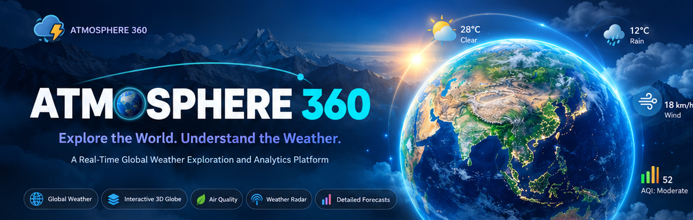

<br />

<h2>Your World. Your Weather. One Interactive Experience.</h2>

<p>
A modern global weather exploration, forecasting and visualization platform.<br />
<i>Search any city, explore the 3D Earth, analyze forecasts and understand conditions at a glance.</i>
</p>

<p>


</p>

<p>


</p>

**[Features](#features)** · **[Screenshots](#application-previews)** · **[Installation](#quick-start-on-windows)** · **[Architecture](#system-architecture)** · **[API](#api-reference)**

</div>

> **Project status:** Local-development application. Forecast data, maps, globe textures and optional historical radar require internet access and availability from third-party services. The weather numbers in the illustrated cover banner are decorative, not a live feed.

---

## Contents

- [Overview](#overview)
- [Features](#features)
- [Application previews](#application-previews)
- [Technology stack](#technology-stack)
- [System architecture](#system-architecture)
- [Quick start on Windows](#quick-start-on-windows)
- [Optional XAMPP/MySQL setup](#optional-xamppmysql-setup)
- [Environment configuration](#environment-configuration)
- [Admin dashboard and privacy](#admin-dashboard-and-privacy)
- [Project structure](#project-structure)
- [API reference](#api-reference)
- [Testing](#testing)
- [Troubleshooting](#troubleshooting)
- [Data accuracy and limitations](#data-accuracy-and-limitations)
- [Attribution](#attribution)

## Overview

**ATMOSPHERE 360** is a responsive full-stack weather experience combining current conditions, forecasting, map-based exploration and visual analytics. Search a city or use coordinates, explore the interactive globe, switch units, inspect air quality and review historical precipitation-radar frames where provided. **Flask** serves the original HTML/CSS/vanilla-JavaScript frontend and communicates with weather services; **SQLite** is the default development database, with **XAMPP MySQL** supported as an alternative.

<div align="center">

| 🌍 Global Explorer | 🌤️ Forecast Dashboard | 📈 Visual Analytics | 🔐 Private Administration |
|:---:|:---:|:---:|:---:|
| Click a 3D Earth location | Today, Hourly and 10-Day | Interactive weather charts | Opt-in search-history insights |

</div>

## Features

| Module | Highlights |
|:---|:---|
| **Today** | Current temperature, feels-like, high/low, humidity, wind, pressure, visibility, clouds, UV and sunrise/sunset |
| **Hourly** | 48-hour conditions with temperature, precipitation and wind graphs |
| **10-day** | Daily forecast, high/low comparisons and precipitation indicators |
| **Weather radar** | Leaflet map with provider-available historical radar frames and playback |
| **Next 60 minutes** | Short-term, model-based precipitation estimates where available |
| **Monthly** | Calendar of dates within the provider's available forecast horizon |
| **Air quality** | Available US AQI, pollutants and hourly trends |
| **Activities** | Weather-based outdoor-condition information |
| **Explore globe** | Rotatable Earth, coordinate selection and optional place-name lookup |
| **Personalization** | Celsius/Fahrenheit, theme preferences, favourite places and autocomplete |
| **Admin console** | Protected access, opt-in search analytics, date filtering, CSV export and manual expired-log purge |

## Application previews

> All previews below are from the supplied screenshots of the actual project. Forecast values represent conditions at the time of capture.

### 01 · Weather dashboard and overview

| Today dashboard | Weather insights and daylight |
|:---:|:---:|
| 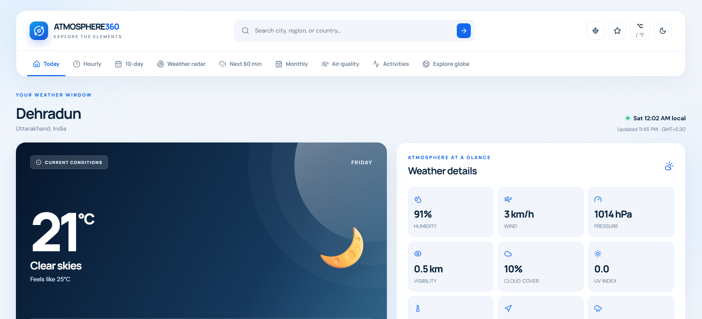 | 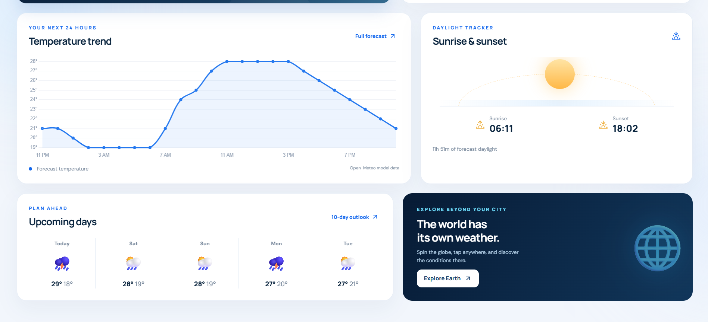 |

### 02 · Forecasts and visual analytics

| Hourly weather | Interactive weather graphs |
|:---:|:---:|
| 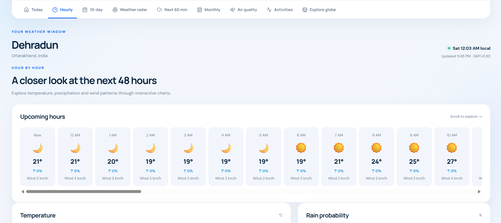 | 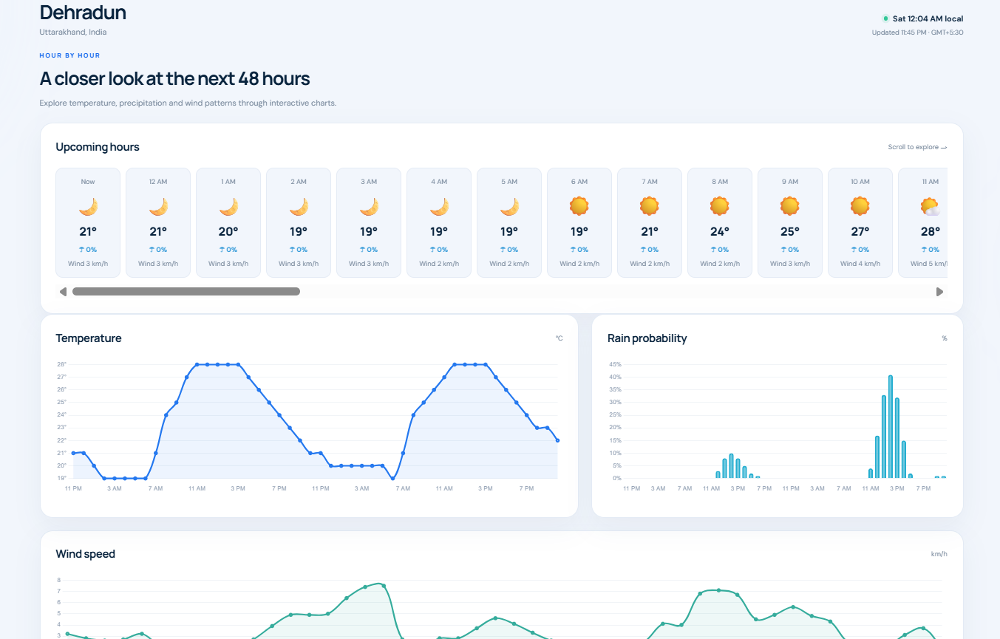 |

| Ten-day forecast | Next 60 minutes |
|:---:|:---:|
| 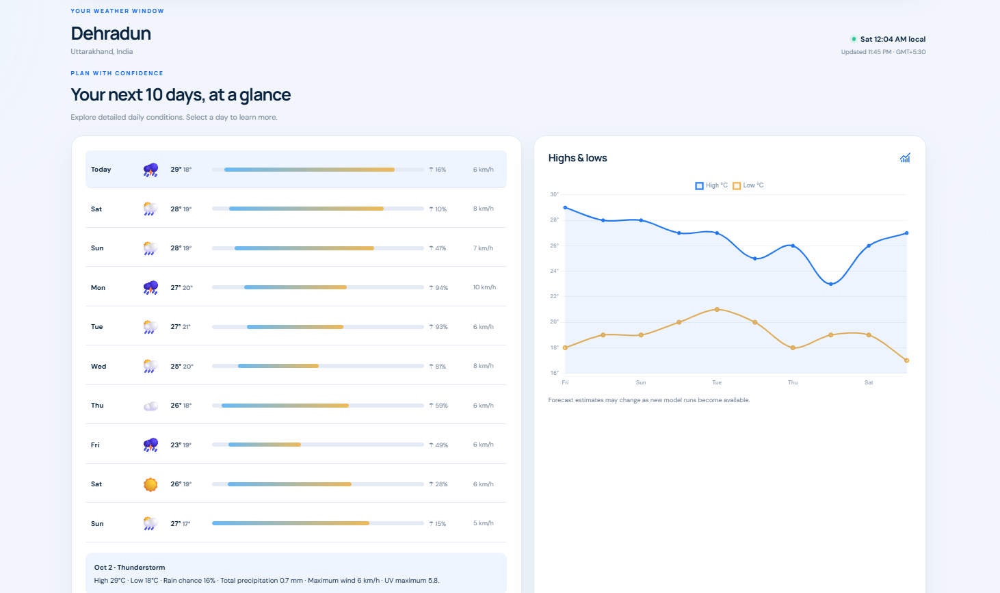 | 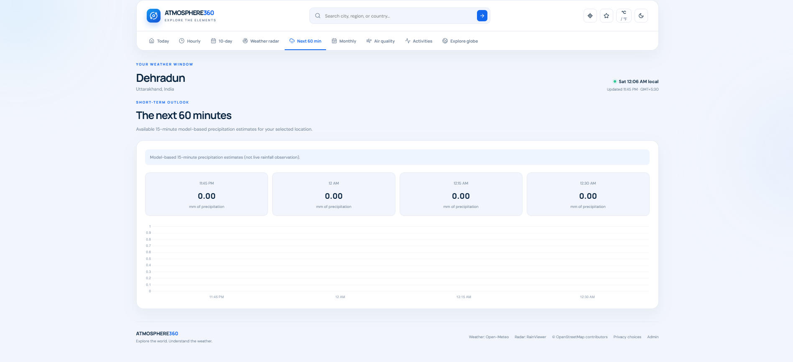 |

### 03 · Radar and monthly calendar

| Interactive radar map | Monthly weather calendar |
|:---:|:---:|
| 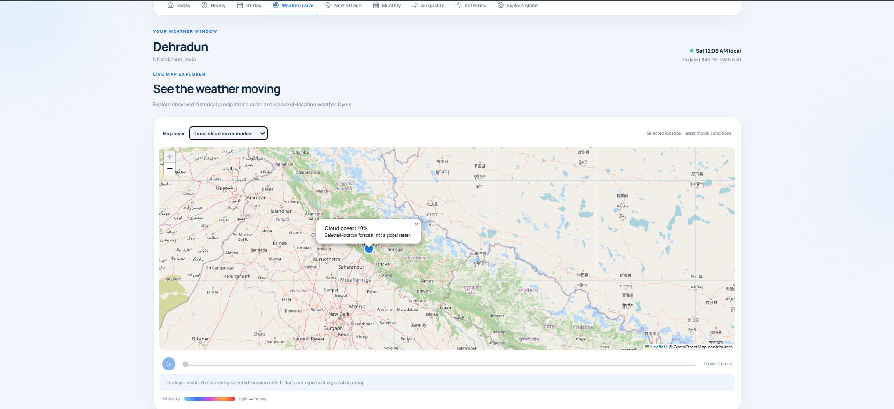 | 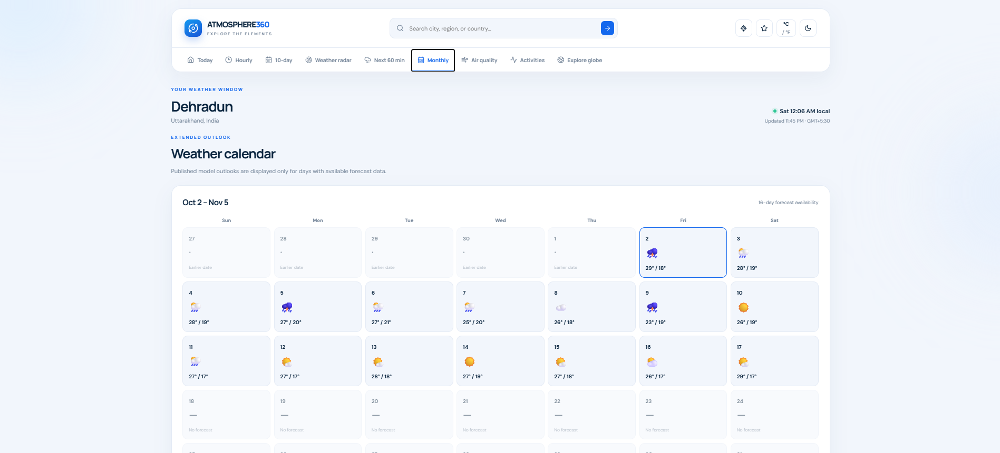 |

### 04 · Environmental conditions

| Air-quality information | Activities and outdoor conditions |
|:---:|:---:|
| 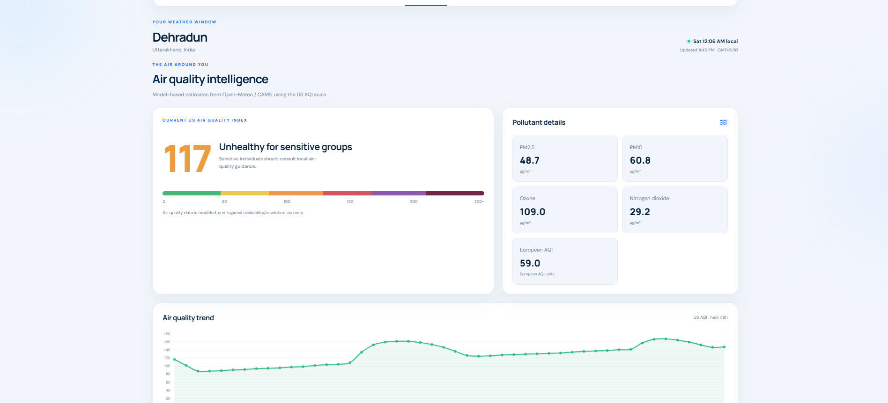 | 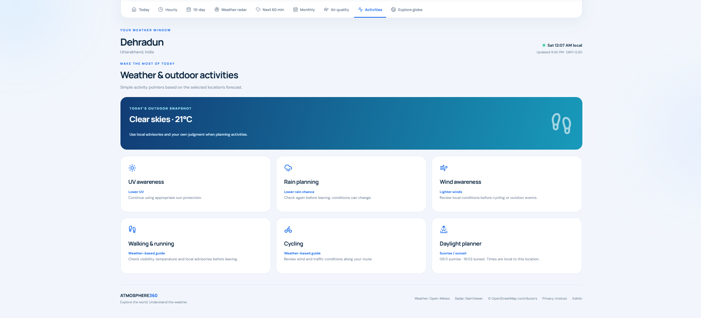 |

### 05 · Explore the interactive Earth

<p align="center">
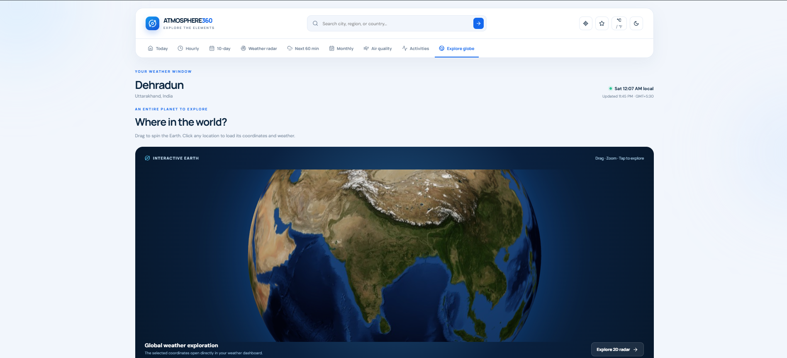
</p>

| Coordinate-based weather | Fahrenheit unit selection |
|:---:|:---:|
| 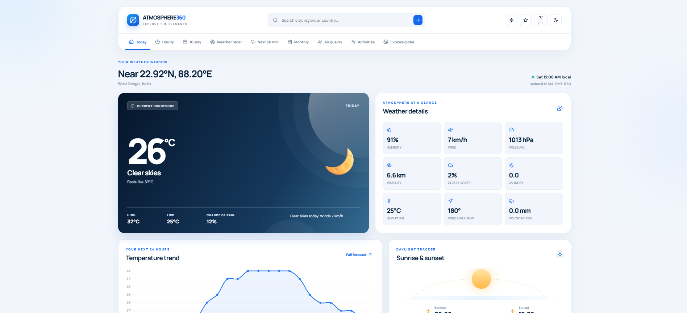 | 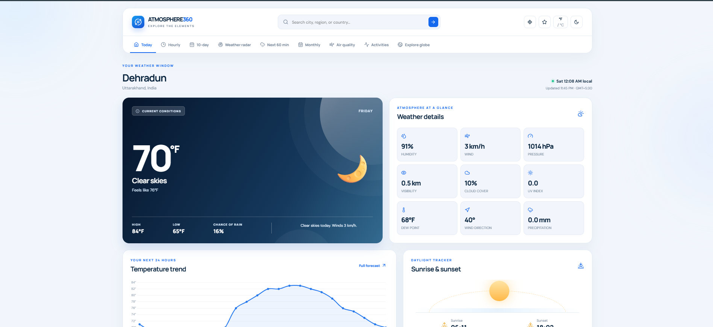 |

Rotate, zoom and click a point on Earth to retrieve its forecast. The weather request uses coordinates, so it does not need to wait for an optional reverse-geocoding lookup.

### 06 · Private admin analytics

<p align="center">
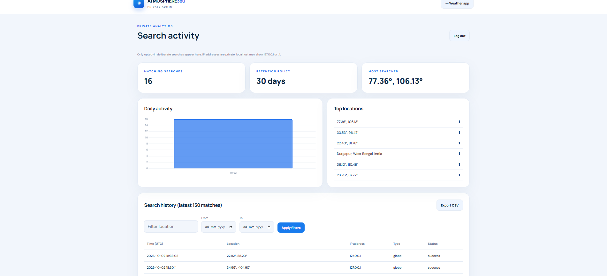
</p>

<details>
<summary><b>View CSV export and local MySQL screenshots</b></summary>

<br />

| Search-log export | MySQL search-log records |
|:---:|:---:|
| 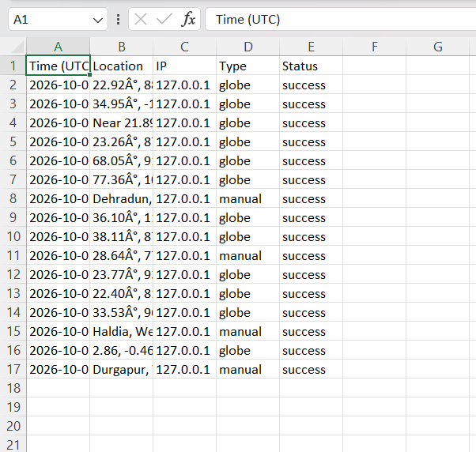 |  |

> **Privacy reminder:** Review these screenshots before publishing publicly; redact any actual visitor addresses or other identifying information.

</details>

---

## Technology stack

| Layer | Technology |
|---|---|
| Interface | HTML5, CSS3, modern vanilla JavaScript |
| Backend | Python 3.10+, Flask, Flask-SQLAlchemy |
| Development database | SQLite (default), or XAMPP MySQL with PyMySQL |
| Forecasting and search | Open-Meteo Forecast, Geocoding and Air Quality APIs |
| Reverse geocoding | OpenStreetMap Nominatim (user-initiated and throttled) |
| Weather radar | RainViewer historical radar metadata/tiles where available |
| 2D map | Leaflet and OpenStreetMap tiles |
| 3D planet | Globe.gl / Three.js (Blue Marble globe texture) |
| Analytics charts | Chart.js |

## System architecture

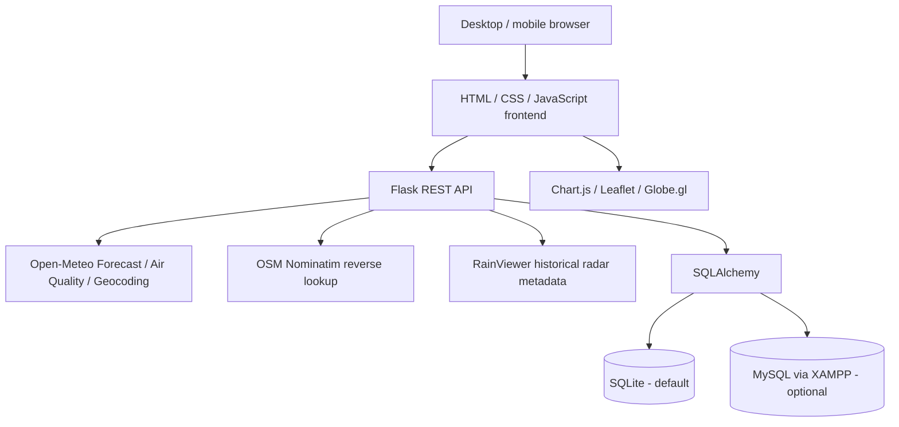

Flask serves the frontend and exposes same-origin `/api/*` routes. Server-side caching reduces duplicate upstream requests. The database stores local administrator accounts and **consented** search logs, not weather forecasts.

## Quick start on Windows

**Prerequisites:** Windows 10/11, Python **3.10+** with PATH enabled, modern browser, internet access. VS Code is recommended. XAMPP is optional if you start with SQLite.

1. Extract this project and open the **`ATMOSPHERE-360` root folder**, where `requirements.txt` exists, in VS Code.
2. Open **Terminal → New Terminal** (PowerShell).
3. Run the commands one by one:

```powershell
py --version
py -m venv .venv
.\.venv\Scripts\python.exe -m pip install -r requirements.txt
Copy-Item .env.example .env
```

4. Open `.env`. Replace `FLASK_SECRET_KEY` with a random value. Generate one with:

```powershell
.\.venv\Scripts\python.exe -c "import secrets; print(secrets.token_hex(32))"
```

5. Leave `DATABASE_URL` **commented out** to use SQLite without XAMPP. Flask creates the database tables automatically.
6. Create your own administrator username/password (at least 12 characters for the password):

```powershell
.\.venv\Scripts\python.exe -m flask --app backend.app create-admin
```

7. Start the server:

```powershell
.\.venv\Scripts\python.exe -m backend.app
```

8. Open these local URLs:

| Page | Local address |
|---|---|
| Weather application | **http://127.0.0.1:5000/** |
| Admin login | **http://127.0.0.1:5000/admin** |
| Backend health check | **http://127.0.0.1:5000/api/health** |

You should see a Flask message resembling `Running on http://127.0.0.1:5000`. **`Debug mode: off` is normal**, not an error. For local-only auto-reloading while editing code, stop the current server with `Ctrl+C` and instead run:

```powershell
.\.venv\Scripts\python.exe -m flask --app backend.app run --debug
```

Do **not** enable the interactive Flask debugger on a public server. You can also double-click `start_windows.bat` after the first-time setup. In **Command Prompt**, replace `Copy-Item .env.example .env` with `copy .env.example .env`.

## Optional XAMPP/MySQL setup

Flask still serves the weather website; XAMPP provides **MySQL** (and Apache only if you want access to phpMyAdmin).

1. Open **XAMPP Control Panel** and start **MySQL**. Start **Apache** to use phpMyAdmin.
2. Go to **http://localhost/phpmyadmin**.
3. Choose **Import**, select `database/atmosphere360.sql`, and click **Import**. The SQL initializes the `atmosphere360` schema and admin/search-log tables.
4. In `.env`, uncomment and set `DATABASE_URL` appropriately. For a local XAMPP root account **without a password**:

```ini
DATABASE_URL=mysql+pymysql://root:@127.0.0.1:3306/atmosphere360
```

5. Restart Flask. Create an admin account **again for MySQL** (previous SQLite admin credentials do not transfer automatically):

```powershell
.\.venv\Scripts\python.exe -m flask --app backend.app create-admin
.\.venv\Scripts\python.exe -m backend.app
```

Avoid using a root database account for an internet-facing deployment. Never put `.env`, user databases, passwords, real IP logs or API tokens into a public repository.

## Environment configuration

Copy `.env.example` to `.env` and customize the values:

| Setting | Purpose | Example |
|---|---|---|
| `FLASK_SECRET_KEY` | Secret for signing Flask sessions; generate a unique long string | *(random 64-character hex)* |
| `DATABASE_URL` | Optional SQLAlchemy connection; when unset, SQLite is used | `mysql+pymysql://root:@127.0.0.1:3306/atmosphere360` |
| `PORT` | Local Flask listening port | `5000` |
| `NOMINATIM_CONTACT` | Contact address identifying this application for reverse-geocoding requests | `contact@example.com` |
| `SEARCH_LOG_RETENTION_DAYS` | Number of days before logs qualify for administrator purge | `30` |

`NOMINATIM_CONTACT` is **not** a login: you do not provide an email password or OTP. Use a suitable project contact address.

## Admin dashboard and privacy

- Browsing weather pages and requesting the browser's current geolocation do **not** create a search log.
- A visitor can accept or decline **optional analytics**. Only consented, deliberate manual/globe searches are eligible for logging.
- Logs may include the request IP, location label, search type, status and time. Globe coordinates are not stored as separate latitude/longitude columns; manually searched coordinates, when logged, are rounded.
- Access to `/admin` requires a separately created account. Passwords are hashed; write actions use CSRF protection.
- Search timestamps are stored in **UTC**. When configured, the admin table formats these UTC timestamps for `Asia/Kolkata` (IST). CSV exports retain **UTC**; phpMyAdmin shows the stored UTC unless you explicitly convert it.
- `SEARCH_LOG_RETENTION_DAYS=30` is a **retention threshold**, not an automatic background deletion schedule. The admin must use **Purge expired logs** periodically.
- `127.0.0.1` / `::1` is expected when testing locally; it is your computer's loopback address, not a visitor's public IP.

> For public deployment, add HTTPS, secure cookies, appropriate proxy configuration, production WSGI hosting and a documented privacy policy. Do not enable debug mode publicly.

## Project structure

```text
ATMOSPHERE-360/
├── README.md
├── requirements.txt
├── .env.example
├── .gitignore
├── start_windows.bat
├── backend/
│   ├── __init__.py
│   └── app.py
├── frontend/
│   ├── index.html
│   ├── admin.html
│   ├── css/style.css
│   ├── js/
│   │   ├── app.js
│   │   ├── api.js
│   │   ├── admin.js
│   │   ├── charts.js
│   │   ├── globe.js
│   │   ├── radar.js
│   │   └── utils.js
│   └── assets/
├── database/atmosphere360.sql
├── docs/
│   ├── SCREENSHOT_INDEX.md
│   ├── assets/
│   │   └── atmosphere-360-banner.png
│   └── screenshots/       # 16 labelled screenshots
├── tests/test_app.py
└── legacy/                 # basic original UI for reference
```

## API reference

| Method | Endpoint | Purpose |
|---|---|---|
| `GET` | `/api/health` | Health check |
| `GET` | `/api/geocode?q=Dehradun` | Location suggestions |
| `GET` | `/api/reverse?lat=30.3&lon=78.0` | Optional coordinate-to-place lookup |
| `GET` | `/api/weather?lat=30.3&lon=78.0` | Forecast and current conditions |
| `GET` | `/api/air?lat=30.3&lon=78.0` | Air quality data |
| `GET` | `/api/radar` | Historical radar metadata |
| `POST` | `/api/consent` | Save optional analytics consent |
| `POST` | `/api/track` | Log a deliberate consented search |
| `POST` | `/api/admin/login` | Administrator login |
| `GET` | `/api/admin/session` | Restore admin session |
| `GET` | `/api/admin/stats` | Filtered logs and aggregates |
| `POST` | `/api/admin/purge` | Manually delete expired records |
| `POST` | `/api/admin/logout` | Sign out |

## Testing

The repository includes Flask tests that mock upstream weather providers (no live external API access required). After installing dependencies:

```powershell
.\.venv\Scripts\python.exe -m pytest -q
```

For a browser smoke test, check: city search, units switch, Today/Hourly/10-day, radar and its provider availability, globe click, AQI, admin login, consent/no-consent and MySQL (when enabled).

## Troubleshooting

| Issue | Check / solution |
|---|---|
| `Debug mode: off` | Expected in normal local startup; use `flask --app backend.app run --debug` only for local editing |
| Python module not found | Use the explicit `.venv\Scripts\python.exe` command from the project root and reinstall requirements |
| MySQL connection refused | Start XAMPP MySQL; verify port, account/password and `DATABASE_URL` |
| Port 5000 is occupied | Set `PORT=5050` in `.env` for `python -m backend.app` and open the new URL |
| Globe/map is blank | Check internet access, third-party CDN loading and WebGL support; use the 2D map as fallback |
| Globe texture seems blurry | Satellite imagery has finite resolution. Zoom out slightly; more zoom does not create extra image detail |
| Coordinates appear before place name | Normal: coordinate weather loads first, reverse-geocoding follows. Remote places may remain coordinate-labelled |
| Weather/radar unavailable | Upstream provider/coverage/connectivity may be unavailable; the app does not invent readings |
| Admin shows `127.0.0.1` | Expected for local browser testing |
| phpMyAdmin time differs from IST | Database stores UTC. Add 5 h 30 min for IST; the admin table formats timestamps in IST |

## Data accuracy and limitations

- **Radar** uses available RainViewer *past* frames, not simulated future radar or a claim of global future coverage. The radar tiles have a native resolution limit.
- **Next 60 minutes** uses model-based short-term estimates when the provider offers them; it is not a direct minute-by-minute radar measurement.
- **Monthly view** shows dates in a calendar but does not fabricate exact weather forecasts beyond the currently available horizon.
- **Globe selection** returns the weather for clicked coordinates. Place names, state names and language depend on reverse-geocoding availability; a satellite texture alone does not show administrative borders.
- **Air quality** uses the provider's available AQI scale and pollutant models; it is not a certified local sensor reading.
- The website requires internet access for live data and several externally loaded visual libraries.

## Attribution

Weather and geocoding: [Open-Meteo](https://open-meteo.com/). Reverse geocoding and basemap geography: [OpenStreetMap contributors](https://www.openstreetmap.org/copyright) / [Nominatim](https://nominatim.org/) / [Leaflet](https://leafletjs.com/). Historical radar: [RainViewer](https://www.rainviewer.com/api/weather-maps-api.html). 3D visualization: [Globe.gl](https://globe.gl/) / [Three.js](https://threejs.org/). Charts: [Chart.js](https://www.chartjs.org/). Icons and fonts: Lucide / Google Fonts. Follow each service's API, attribution, licensing and rate-limit terms.

The `legacy/` folder preserves the original starter UI for comparison; the earlier browser-exposed weather API key has not been included. Rotate/revoke any previously exposed API key before publishing your repository.

---

<div align="center">

**ATMOSPHERE 360** · *Explore the world. Understand the weather.*

</div>
